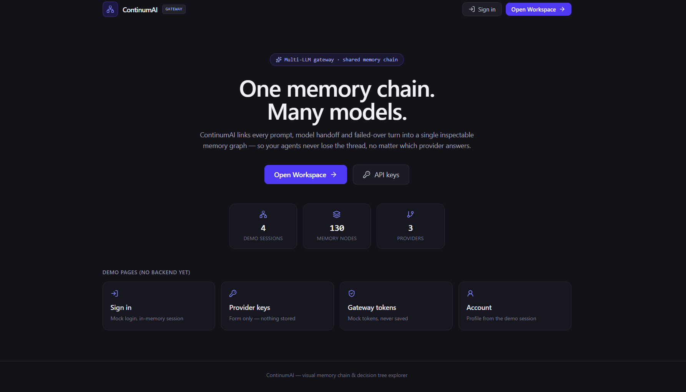
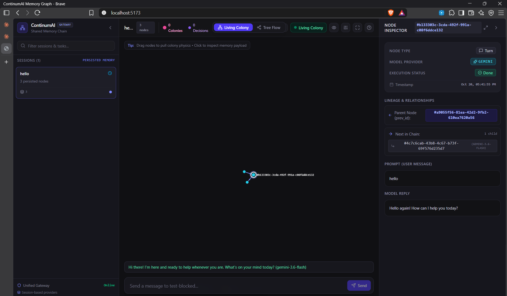
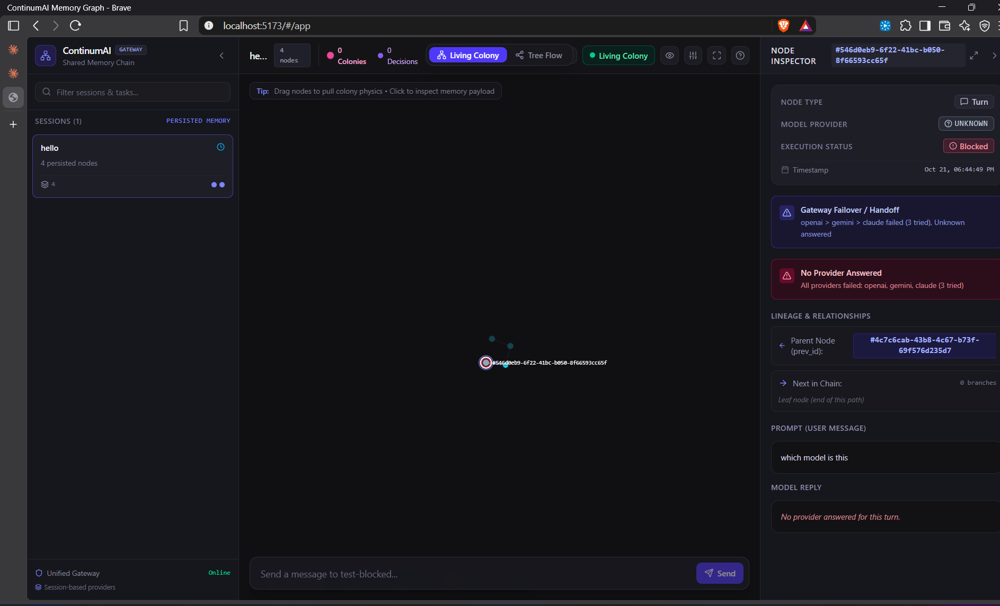

<div align="center">

# ContinumAI

**A multi-LLM gateway with a shared memory chain — one API, many providers, complete failover, zero context loss.**

[](package.json)
[](package.json)
[](graph-frontend)
[](package.json)
[](#license)

</div>

---

## What It Does

Send a message to `POST /chat` and ContinumAI:

1. **Routes it across a provider chain** — OpenAI → Gemini → Claude → NVIDIA NIM → any OpenAI-compatible endpoint — with automatic failover on rate limits and provider errors, and a per-provider call deadline.
2. **Records the exchange in a memory chain** — every turn becomes a node linked by `prev_id`, carrying which provider answered, which providers failed, and the turn status.
3. **Compacts history into checkpoints** — every 5 turns the chain folds into a checkpoint node, so context stays small no matter how long the conversation runs.
4. **Never loses the thread** — the next turn's prompt is rebuilt from the chain, and model handoffs happen transparently mid-conversation.

A React front-end (colony-style graph canvas) visualizes the whole chain — providers, failovers, branches, checkpoints.

<p align="center">
  
</p>

## Architecture

```
                        ┌────────────────────────────────────────────┐
  POST /chat ──────────►│  routes/chat.js                            │
                        │  build prompt from memory chain            │
                        │  iterate providers:  openai, gemini,       │
                        │  claude, nvidia, openai_compat             │
                        │  per-provider timeout (PROVIDER_TIMEOUT_MS)│
                        └──────────────┬─────────────────────────────┘
                                       │ first success wins
                                       │ failures appended to failed_providers
                        ┌──────────────▼─────────────────────────────┐
                        │  memory layer (memory/)                    │
                        │  file store ─ data/sessions/*.json         │
                        │  pg store ─ Supabase/Postgres (optional)   │
                        │  5 turns → auto-checkpoint                 │
                        └──────────────┬─────────────────────────────┘
                                       │
                        ┌──────────────▼─────────────────────────────┐
                        │  graph-frontend (Vite + React)             │
                        │  colony canvas · inspector · landing page  │
                        │  reads via GET /sessions, Proxied by Vite  │
                        └────────────────────────────────────────────┘
```

### Failover Rules

| Situation | Behavior |
|---|---|
| `rate_limit_error` / `provider_error` / timeout | Move to the next provider, record the failure |
| `auth_error` | Also fails over, with a "key looks invalid" warning logged before moving to the next provider |
| All providers fail | Turn is stored as `status: blocked`, `provider: null`, `failed_providers` lists every attempt in order, structured error returned |

Every stored node records `provider` (who answered) and `failed_providers` (who didn't), which is what the inspector and graph use to visualize handoffs.

## Quickstart

### Backend

```bash
npm install
cp .env.example .env    # fill in at least one provider key + GATEWAY_API_TOKEN
npm start               # http://localhost:3000
```

In PowerShell, set the gateway token for the current session without committing it:

```powershell
$env:GATEWAY_API_TOKEN = Read-Host "Enter GATEWAY_API_TOKEN"
npm start
```

The server refuses to start when `GATEWAY_API_TOKEN` is missing unless `ALLOW_UNAUTHENTICATED=true` is set (development only).

### Frontend

```bash
cd graph-frontend
npm install
npm run dev             # http://localhost:5173 — proxies /chat, /sessions, /health, /providers to :3000
```

The Vite dev proxy strips the browser `Origin` header and injects the gateway token (`GATEWAY_API_TOKEN` in `graph-frontend/.env`), so the backend's fail-closed CORS accepts it.

### Tests

```bash
npm test    # 87 tests — stub providers only, never calls real APIs
```

Set `TEST_DATABASE_URL` to also run the Postgres memory contract suite against a throwaway schema (auto-dropped).

## API

| Endpoint | Method | Notes |
|---|---|---|
| `/chat` | `POST` | Body: `{ "session_id": "...", "message": "...", "provider": "nvidia" (optional) }` — `provider`, if set, is tried first with the normal failover chain after it |
| `/sessions` | `GET` | Bearer token required — list of `{ id, node_count, latest_activity, models, title }` |
| `/sessions/:id/nodes` | `GET` | Bearer token required — all nodes for a session; `404` for unknown sessions |
| `/providers` | `GET` | Bearer token required — enabled provider names (those with configured API keys), used by the front-end selector |
| `/health` | `GET` | `{ "status": "ok" }` |

Error shape (all endpoints): `{ error: { type, message, statusCode } }` with types `auth_error`, `rate_limit_error`, `provider_error`, `validation`, `memory_unavailable`, `no_providers`.

**CORS is fail-closed:** set `CORS_ORIGIN` to comma-separated explicit `http`/`https` origins when a browser calls the API. Wildcards are rejected; origins outside the list get `403`. Requests without an `Origin` header (server-to-server) are unaffected.

## Memory Model

Nodes form a chain per session (`prev_id` links), stored either as JSON files or in Postgres:

```json
{
  "node_id": "...",
  "prev_id": "...",
  "type": "turn | decision | checkpoint",
  "content": "user message",
  "reply": "model reply | null",
  "model_used": "gpt",
  "provider": "openai | null",
  "failed_providers": [],
  "status_at_this_point": "done | in_progress | blocked",
  "timestamp": "..."
}
```

- `blocked` turns (all providers failed) are stored but excluded from future prompts and checkpoints.
- Checkpoints hold the text of their 5 covered turns; handoff context = latest checkpoint + trailing turns (≤ 10 `User:` blocks in any prompt).

## Environment Variables

| Variable | Required | Purpose |
|---|---|---|
| `OPENAI_API_KEY` | one of the providers | OpenAI (GPT) |
| `GEMINI_API_KEY` | one of the providers | Google Gemini |
| `ANTHROPIC_API_KEY` | one of the providers | Anthropic Claude |
| `NVIDIA_API_KEY` | one of the providers | NVIDIA NIM (Nemotron, OpenAI-compatible endpoint) |
| `NVIDIA_MODEL` | no | NIM model override (default `nvidia/llama-3.1-nemotron-70b-instruct`) |
| `OPENAI_COMPAT_BASE_URL` / `_API_KEY` / `_MODEL` | no | Generic OpenAI-compatible provider slot |
| `GATEWAY_API_TOKEN` | yes (prod) | Bearer token for authed endpoints |
| `ALLOW_UNAUTHENTICATED` | no | Dev-only bypass for the token |
| `CORS_ORIGIN` | no | Comma-separated allowed browser origins (fail-closed) |
| `PROVIDER_TIMEOUT_MS` | no | Per-provider call deadline, default 30000 |
| `DATABASE_URL` | no | When set, memory uses Postgres/Supabase instead of files |
| `SESSIONS_DIR` | no | Override the file-store directory |

Only one provider key needs to be present — enabled providers join the chain automatically.

## Project Structure

```
continumai/
├── server.js               # Express app factory, auth, CORS, health
├── routes/
│   ├── chat.js             # Provider chain, failover, memory writes
│   └── sessions.js         # GET /sessions, GET /sessions/:id/nodes
├── providers/
│   ├── index.js            # buildProviders() — registry driven by env keys
│   ├── openai.js / gemini.js / claude.js
│   ├── nvidia.js           # NIM wrapper over the shared OpenAI-compat sender
│   ├── openaiCompat.js     # reusable OpenAI-compatible sender
│   ├── errorClassifier.js  # shared error classification
│   └── timeout.js          # provider deadline parsing
├── memory/
│   ├── memory.js           # chain, checkpoints, serialization per session
│   ├── fileStore.js        # default store — data/sessions/*.json
│   ├── pgStore.js / pgPool.js   # Postgres store (used when DATABASE_URL set)
├── db/schema.sql           # Postgres schema (npm run migrate)
├── scripts/migrate.js      # applies db/schema.sql
├── test/                   # node:test — gateway, memory contracts, sessions
└── graph-frontend/         # Vite + React
    └── src/
        ├── App.tsx         # workspace: graph canvas + inspector + chat bar
        ├── pages/          # Root (hash router), Landing, demo pages
        ├── auth.ts         # demo-only mock auth (no backend yet)
        ├── api/client.ts   # real data layer — /sessions, /chat
        └── components/     # ColonyCanvasView, DetailPanel, SessionSidebar, nodes/
```

## Frontend

Landing page → **Open Workspace** → the memory-graph workspace:
- **Colony canvas** — d3-force particle graph clustered around checkpoints; node color = answering provider; `decision` nodes branch, dashed edges are references.
- **Node inspector** — prompt/reply, provider badge (OpenAI / Gemini / Claude / unknown), failover banner (`"A > B failed, C answered"` — wording only appears when `failed_providers` is non-empty), lineage jumping.
- **Session sidebar** — persisted session list with filter, fork/count stats.
- **Demo pages** (Sign in, Provider keys, Gateway tokens, Account) are clearly labelled **"Demo, not saved"** — no backend exists for them; typed keys are never stored anywhere.

Routes are hash-based: `#/` landing, `#/app` workspace, `#/demo/*` demo pages.

### Workspace — successful turn

The node inspector shows who answered (`provider` badge), the chain lineage, and the full prompt/reply payload.

<p align="center">
  
</p>

### Workspace — failover and blocked turn

When providers fail, the stored node keeps the trail: the failover banner (`openai > gemini > claude failed (3 tried)`) and `failed_providers` on the node itself.

<p align="center">
  
</p>

## Deployment (Railway)

1. Deploy from GitHub; Railway auto-detects Node.js.
2. Add the env vars from the table above to the service.
3. Set `DATABASE_URL` so the memory survives redeploys; file-only storage keeps sessions on an ephemeral disk.
4. Verify: `GET /health` → `{"status":"ok"}`; send two `POST /chat` turns with the same `session_id` and confirm the second retains context after a redeploy.

## Decision Ladder

Every change follows this priority, in order:

1. **YAGNI** — does this need to exist at all?
2. **Standard library** — can built-ins do it?
3. **Native runtime/platform**
4. **Existing dependency**
5. **One line**
6. **Minimum new code** — nothing speculative

## Roadmap

- [ ] Smarter failover — latency-based picking, token-limit awareness
- [ ] Real auth for the demo pages (backend pending)
- [ ] Provider health metrics + failover analytics dashboard
- [ ] SSE/streaming replies

## License

ISC
